<div align="center">

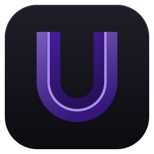

# Uzai

**Your Windows PC, as a console.**

Every game on your PC, from Steam to your emulators, in one controller-first frontend.


**[Download](../../releases/latest)** · [Website](https://uzai77.github.io/Uzai/) · [Features](#features) · [Get Uzai](#get-uzai) · [Privacy](#privacy) · [Build](#build-from-source) · [Deutsch](docs/README.de.md)

<br>

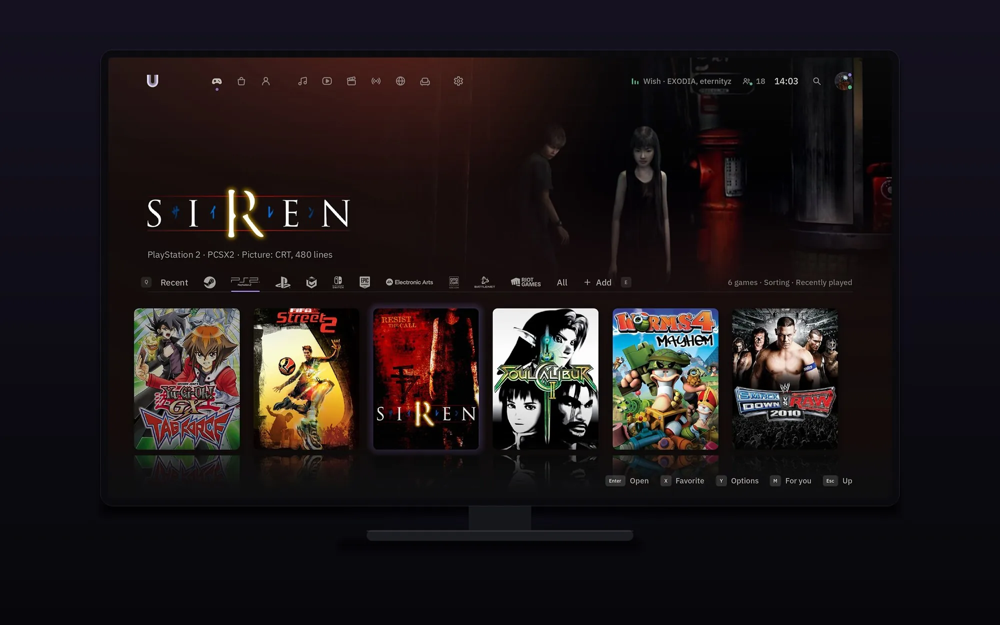

<sub>Steam · Epic · EA · GOG · Ubisoft · Battle.net · Xbox · Amazon · Riot · itch.io<br>
Found automatically · 34 emulator templates</sub>

</div>

<br>

## Features

### Every game

**One library.** Uzai scans your PC for every game, from Steam, Epic and GOG to your emulators and ROMs, and puts
them all in one library.

### In a game

<table>
<tr>
<td width="50%" valign="top">

**The Guide**<br>
Press the Guide button in any game and Uzai opens on top: friends, Discord, music, captures and power, without leaving
the game.

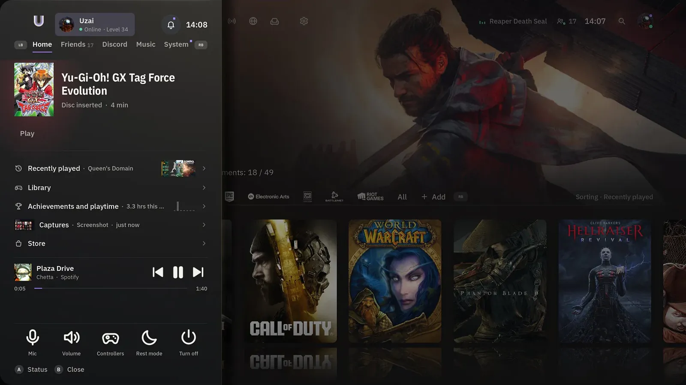

</td>
<td width="50%" valign="top">

**Quick menu**<br>
Hold the Guide button for the essentials: screenshot, the last 30 seconds as a clip, mic on and off, rest mode or quit.
You choose which tiles it shows.

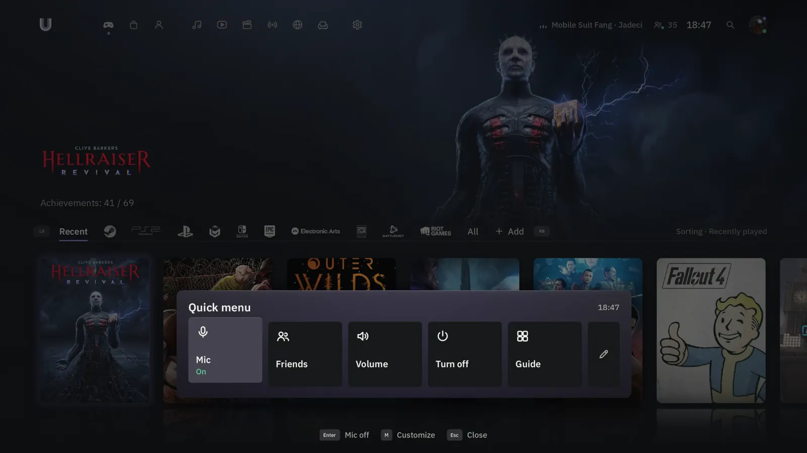

</td>
</tr>
<tr>
<td width="50%" valign="top">

**Friends and Discord**<br>
Steam and Discord friends in one list, with chat, voice channels and invites, while you play.

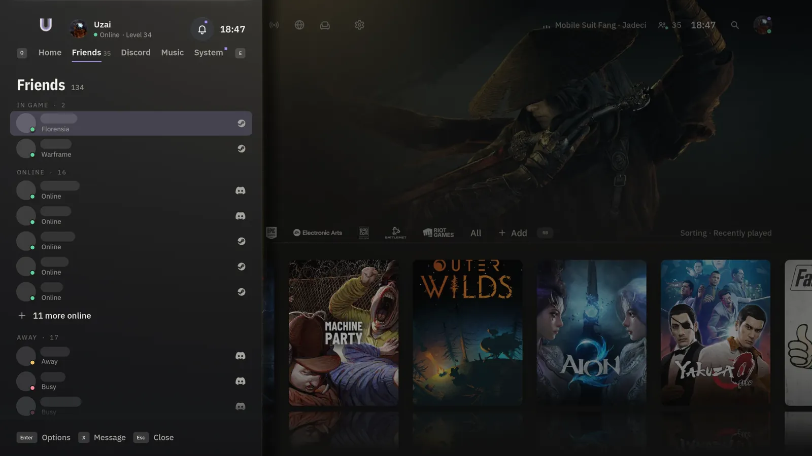

</td>
<td width="50%" valign="top">

**Music while you play**<br>
Spotify with queue, playlists and liked songs, or your own music, without leaving the game.

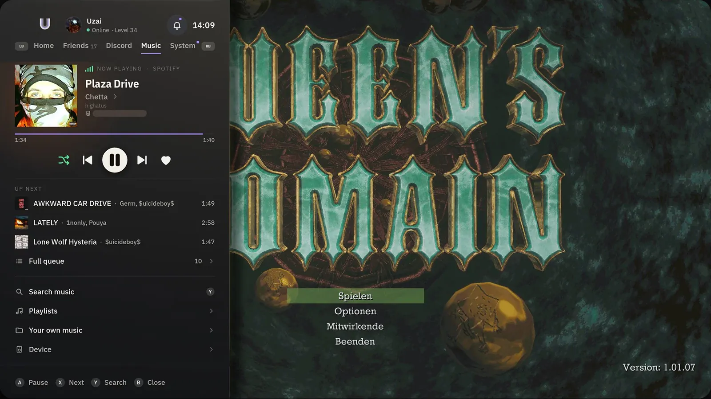

</td>
</tr>
</table>

### Library

<table>
<tr>
<td width="50%" valign="top">

**Store**<br>
The Steam store made for a controller: deals, wishlist, trailers, reviews and search. Free Epic games too.

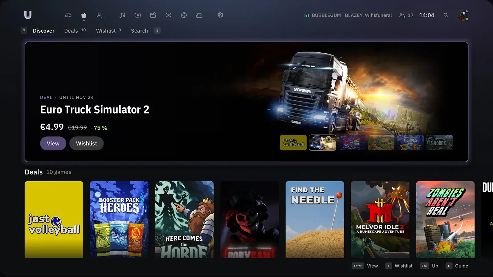

</td>
<td width="50%" valign="top">

**Artwork your way**<br>
Covers, backgrounds, logos and icons from SteamGridDB or iiDB, picked with the controller.

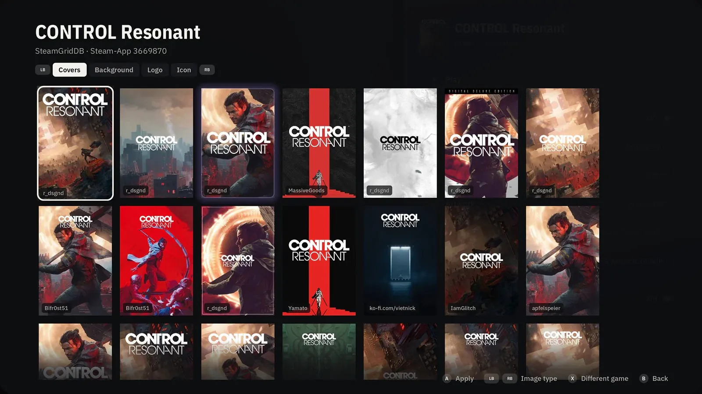

</td>
</tr>
<tr>
<td width="50%" valign="top">

**Profile**<br>
Your level, playtime, most-played games and backlog in one place.

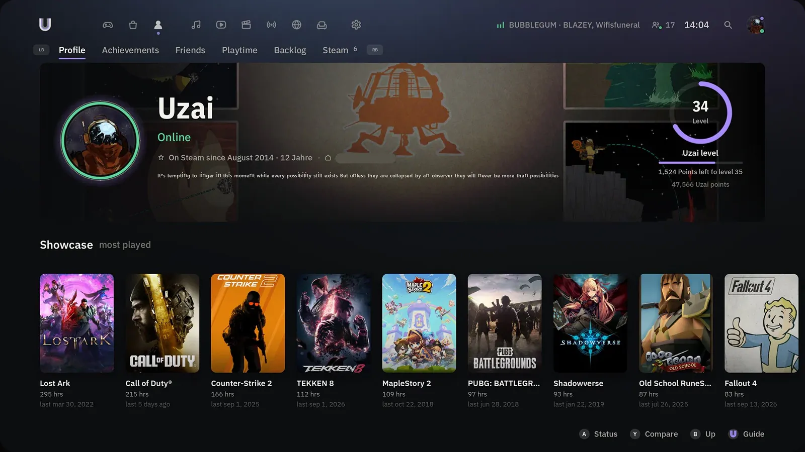

</td>
<td width="50%" valign="top">

**Achievements**<br>
Steam achievements, RetroAchievements for emulated games and Uzai's own levels, with a pop-up in every game.

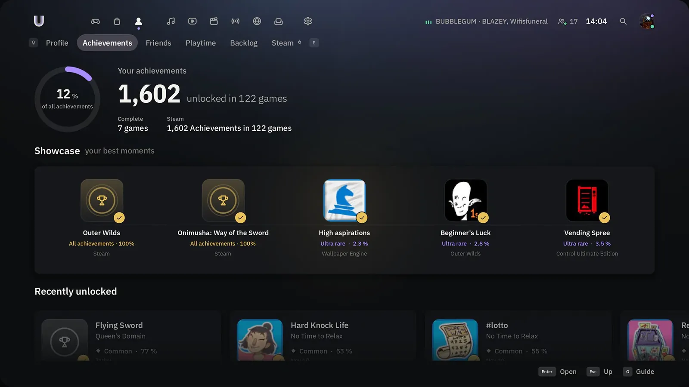

</td>
</tr>
</table>

### Watch

<table>
<tr>
<td width="50%" valign="top">

**YouTube**<br>
Recommendations, subscriptions, Shorts and search. Sign in once with a code, like on a TV.

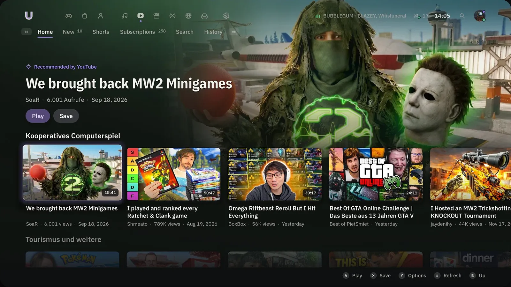

</td>
<td width="50%" valign="top">

**Twitch**<br>
Browse categories and the channels you follow. Streams play right inside Uzai.

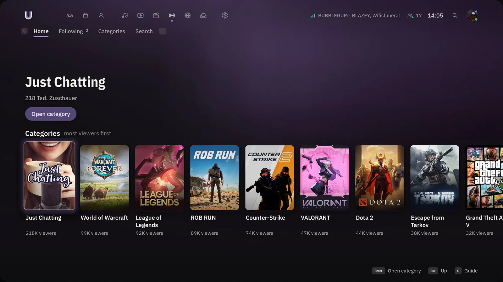

</td>
</tr>
<tr>
<td width="50%" valign="top">

**Movies and shows**<br>
Plex, Jellyfin, Emby and add-on sources in one place, with picture-in-picture while you game.

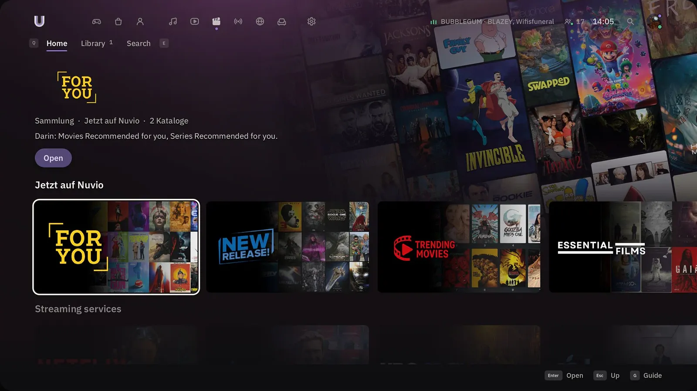

</td>
<td width="50%" valign="top">

**Your Room**<br>
A small 3D room of your own: furnish it and put your games on the shelf. Invite friends who use Uzai over with a
code, and play your local games together online with Remote Play Together.

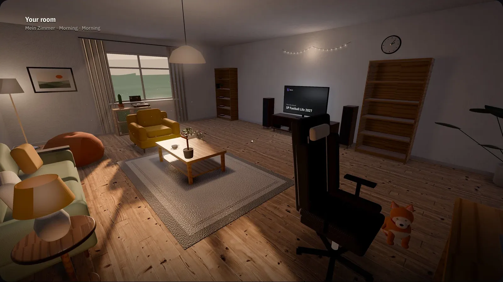

</td>
</tr>
</table>

### Also inside

- **Every store, one library.** Steam, Epic, EA, GOG, Ubisoft, Battle.net, Xbox, Amazon, Riot and itch.io, found automatically.
- **34 emulator templates.** Games start straight in full screen, with CRT filters for the classics.
- **Insert a disc.** A PS1 or PS2 disc in the drive comes first on the home screen and plays from your copy or the disc.
- **Captures.** A gallery to trim and share, and a QR code to get them onto your phone.
- **A browser for the couch.** Every link is a target, with tabs, zoom and reader mode.
- **Feels like a console.** Starts with Windows, rest mode and quick resume.

<br>

## Get Uzai

Windows 10 or 11 (64-bit) and an Xbox or PlayStation controller. Keyboard and mouse work too.

1. **Download** `Uzai-<version>-windows.zip` from [Releases](../../releases/latest).
2. **Unzip and start.** Unzip it anywhere and start `Uzai.exe`. Keep `Uzai.pck` next to it.
3. **Set up.** A short setup walks you through controller, game folders and accounts. Every account is optional.

**Updates install themselves.** Uzai checks for a new release once a day, verifies its signature and puts it in
place when you close Uzai. Change it under *Settings › System › Updates*.

**Portable.** Create an empty folder `uzai-daten` next to `Uzai.exe`.

> [!IMPORTANT]
> Uzai contains **no games, ROMs, BIOS files or console keys** and never downloads them. Emulators need your own
> dumps of games and system files you own.

> [!NOTE]
> **The Guide button.** So that it opens only Uzai, Uzai turns off Steam's own Guide-button shortcut on first start.
> It asks first, you can keep Steam's, and you can switch it back under *Settings › Controller*.

### Controls

Every screen in Uzai works with a controller. Keyboard and mouse work too.

| Button | What it does |
|---|---|
| **A** / **B** | Select / back |
| **X** / **Y** | Extra actions, always shown at the bottom of the screen |
| **LB** / **RB** | Switch rows and tabs |
| **LT** / **RT** | Switch areas: games, store, profile, apps, settings |
| **Guide** | The Guide, also in a game. Hold it for the quick menu |
| **View + Start** | The Guide, if Windows or Steam already use the Guide button |
| **R3** | Search everything |

<br>

## Privacy

Nothing is sent anywhere unless you connect a service.

- **No account needed.** Steam, Epic and PC games are found without signing in. Every sign-in is optional.
- **Your sign-ins stay on your PC.** In the Windows credential vault, never in plain files, logs or URLs.
- **No telemetry.** The daily update check only asks GitHub for the latest release.
- **Signed updates.** An update is installed only if its signature matches the key built into Uzai.

<br>

## Build from source

Uzai is written in GDScript with **Godot 4.5.1**. The whole interface is built in code.

<details>
<summary>Commands, tests and packaging</summary>

<br>

You need Godot 4.5.1 and, for exporting, its Windows export templates (*Editor › Manage Export Templates*).
Uzai keeps its data in `%APPDATA%\Uzai`; point `UZAI_DATA` at an empty folder so tests and demo runs never touch it.

```bash
export UZAI_DATA="$PWD/uzai-daten-test"                              # PowerShell: $env:UZAI_DATA = "…"
godot --headless --path . --import                                  # once, after cloning
godot --path . -- --demo --windowed --no-boot                       # run with demo data
godot --headless --path . res://tests/check.tscn                    # check every script
python tools/lint_gd.py                                             # project lint rules
UZAI_GODOT=godot bash tools/build_windows.sh Uzai-<version>-windows.zip  # package from a clean checkout
```

`tools/build_windows.sh` exports from a clean checkout of the current commit. The Discord SDK
(`discord_partner_sdk.dll`) is not in the repository; without it, Discord messages are off. The character models of
the Room are not in the repository either (their license allows use in Uzai, not re-uploading the files); without
them the Room has no visible character. Releases are signed with `tools/release_signieren.gd` (see
[`docs/SECURITY.md`](docs/SECURITY.md)). Logic tests are in `tests/`, the website in [`website/`](website/). The full German manual is [`docs/README.de.md`](docs/README.de.md); code
comments are German.

</details>

<br>

## Legal

Uzai is not affiliated with Valve, Microsoft, Sony, Nintendo, Epic Games, Electronic Arts, Spotify, Discord,
Google or Twitch. Game titles, artwork and logos in the screenshots belong to their owners and only illustrate
the software. yt-dlp, mpv and Deno are downloaded and run as separate programs; ad-free YouTube playback may
break YouTube's terms. Console logos are loaded from Wikimedia Commons at runtime. Fonts are under the SIL Open
Font License (`assets/fonts/`). To report a security problem, see [`SECURITY.md`](SECURITY.md).

**License:** [GPL-3.0](LICENSE), with an [additional permission](LICENSE-EXCEPTION) to combine Uzai with the
Discord Social SDK, which keeps its own terms. Bundled fonts, models, sounds and the browser filter list keep their own licenses;
they are listed under *About Uzai* in the settings and next to the files (`LIZENZ.txt`).
